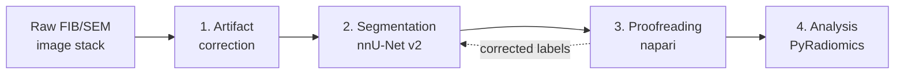

# Cryo-vEM Pipeline

Step-by-step documentation and scripts for cryogenic volume electron microscopy (cryo-vEM) of tissue imaged by cryo-FIB/SEM: from raw image stacks to segmented, proofread, and measured organelles.

The examples use mitochondria in postmortem human retina rod cell, but each step is written to work for other structures/organelles and other tissues.

## Pipeline



| Step | What it does | Main tools | Output |
|---|---|---|---|
| [1. Artifact correction](docs/01-artifact-correction.md) | Aligns slices, removes curtaining stripes, denoises, and enhances contrast | Wavelet–Fourier destriping (Python port of the MATLAB workflow) | Corrected volume |
| [2. Segmentation](docs/02-segmentation.md) | Labels the target structure, with iterative training to keep manual annotation low | nnU-Net v2 (ResEnc presets), optional filter toolbox (CLAHE, Frangi, denoising) | Semantic mask |
| [3. Proofreading](docs/03-proofreading.md) | Splits the mask into individual objects, ranks likely errors, and fixes them by hand | [vem-proofreader](TODO-link-to-repo) (napari) | Instance labels + cell map |
| [4. Statistical analysis](docs/04-statistical-analysis.md) | Measures each object's shape, applies quality filters, and describes the sample per cell | PyRadiomics shape features, pandas, matplotlib | Object table, summaries, plots |

Proofread labels can also be fed back into training to improve the segmentation model (see [3. Proofreading](docs/03-proofreading.md#feeding-corrections-back-into-training)).

## Repository layout
```
cryo-vem-pipeline/
├── README.md
├── docs/
│   ├── 01-artifact-correction.md
│   ├── 02-segmentation.md
│   ├── 03-proofreading.md
│   ├── 04-statistical-analysis.md
│   └── images/                       ← figures used in the docs
└── scripts/
    ├── destriping/                   ← step 1
    │   ├── destripe.py               ← core wavelet–Fourier filter
    │   ├── best_parameters.py        ← sweep decomposition level and sigma
    │   ├── best_wavelet.py           ← score Daubechies wavelets
    │   ├── wavelet_fft.py            ← apply to a whole stack
    │   └── requirements.txt
    └── analysis/                     ← step 4
        ├── Dockerfile.radiomics      ← pinned environment for PyRadiomics
        ├── export_cells_to_mrc.py    ← optional per-cell crops
        ├── radiomics_per_mito.py     ← shape features per object
        ├── combine_results.py        ← combine volumes, flag border objects
        ├── filter_objects.py         ← quality filters
        ├── describe_sample.py        ← summaries, redundant features, plots
        └── volume_fraction.py        ← optional volume fraction per cell
```
The proofreading tool lives in its own repository: [vem-proofreader](TODO-link-to-repo).

## Getting started
```bash
git clone TODO-link-to-this-repo cryo-vem-pipeline
cd cryo-vem-pipeline
```

Then follow the steps in order, starting with [1. Artifact correction](docs/01-artifact-correction.md). Each page lists its inputs, requirements, procedure, outputs, a quality checklist, and troubleshooting.

Every script has a built-in help page:
```bash
python scripts/analysis/filter_objects.py --help
```

### Environments
The steps have different requirements, so separate environments are recommended:

| Environment | Used for | Setup |
|---|---|---|
| Destriping | Step 1 | Python 3.10+; `pip install -r scripts/destriping/requirements.txt` |
| nnU-Net | Step 2 | Python 3.10+ with a CUDA-enabled PyTorch, installed **before** `nnunetv2`; NVIDIA GPU with ≥10 GB memory for training. See [2. Segmentation](docs/02-segmentation.md#requirements). |
| Proofreading | Step 3 | Python 3.10–3.12 (napari doesn't support 3.13+ yet); `pip install -r requirements.txt` in the vem-proofreader repo |
| PyRadiomics | Step 4, feature extraction | Docker: `docker build -f scripts/analysis/Dockerfile.radiomics -t vem-radiomics scripts/analysis`, or Python 3.11 with PyRadiomics 3.0.1 (it doesn't build on newer versions) |
| Analysis | Step 4, everything else | Python 3.10+; `pip install numpy pandas scipy matplotlib mrcfile` |

## Data flow
| From | File | To |
|---|---|---|
| 1. Artifact correction | `corrected_volume.tif` | 2. Segmentation (input), 3. Proofreading (background image) |
| 2. Segmentation | `semantic_mask.tif` | 3. Proofreading |
| 3. Proofreading | `<output>.mrc` (instance labels) | 4. Analysis, and back to 2. Segmentation as training data |
| 3. Proofreading | `<output>_cellmap.csv` (`instance_id → cell_id`) | 4. Analysis |
| 4. Analysis | `objects_filtered.csv`, `results/description/` | Reporting |

## Conventions
These hold across all steps. Most errors between steps come from breaking one of them.

- **Axis order.** Arrays are always `(z, y, x)`.
- **Voxel size flags are `x y z`.** Command-line options named `--spacing_nm` (proofreader, `radiomics_per_mito.py`, `volume_fraction.py`) take `x y z` in nm, the reverse of the array order. For anisotropic FIB/SEM data, z is usually the largest value. **Always set it explicitly**; file headers are not trusted.
- **Units.** Voxel sizes in nm. PyRadiomics features are in µm, µm², and µm³.
- **Labels.** `0` is background in every label volume. A `cell_id` of `0` means the object isn't assigned to a cell.
- **IDs.** Instance IDs are unique within a volume. `cell_uid` (e.g. `vol01_5`) is unique across volumes.

## Key recommendations
A few points from testing that affect results, explained in detail in the step pages:

- **Destriping:** tune decomposition level and sigma first, then choose the wavelet, and confirm the choice visually on a test slice; the combined score can exaggerate small differences between wavelets ([1.2](docs/01-artifact-correction.md#12-curtaining-removal-destriping)).
- **nnU-Net:** neighboring FIB/SEM slices are nearly identical, so split training and validation data by region, not at random, or validation scores will be too optimistic ([2.4](docs/02-segmentation.md#24-train-the-first-2d-model)).
- **Filters:** a model trained on filtered images needs the same filters, with the same parameters, on every volume it predicts ([Part C](docs/02-segmentation.md#part-c-filter-toolbox-optional)).
- **Proofreading:** save with **Save MRC** during the session; don't rely on the automatic save when the window closes ([3.6](docs/03-proofreading.md#36-save)).
- **Feature extraction:** use `--max_voxels_pyrad 0` if memory allows. Otherwise large objects are measured on a coarser grid than small ones, which shifts surface area and sphericity ([4.1](docs/04-statistical-analysis.md#41-extract-shape-features-with-pyradiomics)).
- **Per-cell exports:** always use `--export_relabel`; without it, instance IDs above 65,535 wrap around and objects can merge ([4.1](docs/04-statistical-analysis.md#41-extract-shape-features-with-pyradiomics)).

## Citation
If you use this pipeline, please cite:

`TODO`: manuscript citation.

The pipeline builds on these tools; please cite them too:

- **nnU-Net:** Isensee F, Jaeger PF, Kohl SAA, Petersen J, Maier-Hein KH (2021). nnU-Net: a self-configuring method for deep learning-based biomedical image segmentation. *Nature Methods* 18:203–211.
- **nnU-Net ResEnc presets:** Isensee F, et al. (2024). nnU-Net Revisited: A Call for Rigorous Validation in 3D Medical Image Segmentation. *MICCAI 2024*.
- **PyRadiomics:** van Griethuysen JJM, Fedorov A, Parmar C, et al. (2017). Computational radiomics system to decode the radiographic phenotype. *Cancer Research* 77(21):e104–e107.
- **Wavelet–Fourier destriping:** Münch B, Trtik P, Marone F, Stampanoni M (2009). Stripe and ring artifact removal with combined wavelet–Fourier filtering. *Optics Express* 17(10):8567–8591.
- **napari:** napari contributors. napari: a multi-dimensional image viewer for Python. doi:10.5281/zenodo.3555620
