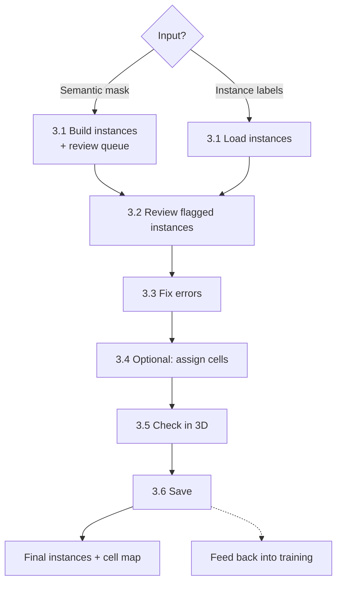

# 3. Proofreading

## Goal
Turn the semantic segmentation into instance labels, where each object has exactly one ID, using [vem-proofreader](TODO-link-to-repo). The tool:

1. **Bulds instances** from a semantic mask (or loads existing ones), splitting touching objects conservatively.
2. **Ranks what to review.** Every instance gets a score from simple geometric checks, so you review the likely errors first instead of the whole volume.
3. **Opens napari for fixing labels.** Merge, split, delete, fill, and assign are each one button, with undo,

 The output is a corrected instance label volume ready for analysis. This process can be used to feed back into training as well ([2. Segmentation](02-segmentation.md)).

 > **Why over-split on purpose?** In densely packed tissue, the most common error is two touching objects merged into one label. Merging by hand is faster than splitting, so the automatic step over-splits and leaves the remaining merges for you to fix.

## Inputs
| Item | Format | Notes |
|---|---|---|
| Semantic mask **or** instance labels | `.mrc`, `.tif`/`.tiff` (file or folder of slices), `.nii`/`.nii.gz`, `.npy` | Semantic mask from [2.8](02-segmentation.md#28-predict-the-full-volume), or instances from [Part B](02-segmentation.md#part-b-instance-separation-optional) or a previous session |
| Data volume | Same formats | The filtered volume from [1. Artifact correction](01-artifact-correction.md), shown as the background layer (raw volume / any filtered versions can be used too) |
| Voxel size | nm, given as **x y z** | Always set it on the command line; file headers may not include this information |
| Cell labels (optional) | Same formats | One ID per cell, if you want to record which cell each object belongs to |

## Requirements
- Python **3.10-3.12** (napari doesn't support 3.13+ yet; everything except the viewer runs on any recent Python)
- Packages in the tool's `requirements.txt`: `numpy`, `pandas`, `scipy`, `scikit-image`, `mrcfile`, `napari`, `magicgui`, `qtpy`, `Pillow`, `PySide6`, plus `tifffile` (TIFF) and `nibabel` (NIfTI) for those formats
```bash
git clone TODO-link-to-repo vem-proofreader
cd vem-proofreader
conda create -n vem python=3.11
conda activate vem
pip install -r requirements.txt
```
The modules import each other by name, so run the commands from inside the `vem-proofreader` folder.

## Overview


## Error types

| Error | What it looks like | Fix in the tool |
|---|---|---|
| **Merge** | Two or more objects share one ID | **Split selected label using seeds** |
| **Split** | One object has several IDs, often at a constriction or a gap between slices | **Merge labels at points** |
| **Partial split** | A piece of one object belongs to its neighbor | **Merge CC at seed** |
| **False positive** | A labeled region that isn't the target | **Delete selected label** |
| **False negative** | A target with no label | **Create new label**, then paint |
| **Holes** | Gaps inside an object within a slice | **Fill holes in slices** |
| **Boundary error** | The label leaks past the membrane or stops short of it | Paint or erase with napari's brush |

## Procedure
### 3.1 Start a session
```bash
python napari_session.py \
    --input      semantic_mask.mrc \
    --semantic \
    --raw        volume.mrc \
    --output     instances.mrc \
    --spacing_nm 5 5 20 #Your voxel size\
    --napari
```

**From existing instance labels** (e.g. from [Part B](02-segmentation.md#part-b-instance-separation-optional) or another tool):

```bash
python napari_session.py \
    --load_instances instances.tif \
    --raw            volume.mrc \
    --output         instances_proofread.mrc \
    --spacing_nm     5 5 20 #Your voxel size\
    --napari
```

**Interactively**, by choosing files in a dialog:

```bash
python napari_session.py --napari
```
napari opens empty, and a dialog asks for the label file, the raw volume, and a save folder. Tick **Compute automatic watershed first** if the label file is a semantic mask; leave it unticked if it's already an instance volume.

> **`--spacing_nm` is in x y z order**, unlike the (z, y, x) order used for arrays elsewhere in these docs. For anisotropic FIB-SEM data, z is usually the largest value. A wrong value gives the wrong aspect ratio in 3D and wrong distances for splitting.

#### How instances are built from a semantic mask

1. **Select components.** Label connected components, drop those smaller than `--min_instance_voxels`, and mark unusually large ones (above median + k × MAD of the sizes).
2. **Split (optional, off by default).** Two strategies, which can be combined:
   - **Pre-split** (`--pre_split_xy_erosion_iters 1`): erodes in XY only and assigns each voxel to the nearest surviving piece. Fast, for very large clusters of touching objects. Erosion is XY-only because z sampling can be much coarser (depending on your voxel size), and eroding in z would destroy thin structures.
   - **Watershed** (`--watershed_first`): a distance-transform watershed for components that look multi-lobed or are unusually large.
3. **Score.** Each instance gets a review score (next section).

| Situation | Suggested flags |
|---|---|
| Objects rarely touch | Defaults (no splitting) |
| Many touching, multi-lobed objects | `--watershed_first` |
| Huge clusters of touching objects | `--pre_split_xy_erosion_iters 1`, optionally with `--watershed_first` |
| Too many over-split objects | Raise `--ws_strong_peak_frac` (toward 0.85) and `--min_sep_nm`, or turn splitting off and merge by hand |

Main parameters (all flags are listed in the tool's README):

| Flag | Default | Effect |
|---|---|---|
| `--min_instance_voxels` | `100` | Drop components smaller than this |
| `--min_sep_nm` | `120` | Minimum distance between distance-transform peaks to count as separate lobes; set near the typical object diameter |
| `--ws_strong_peak_frac` | `0.75` | Higher means fewer watershed seeds and less splitting |
| `--ws_max_seeds` | `4` | Maximum parts per component |
| `--ws_min_voxels` | `10000` | Only watershed components at least this large |
| `--size_outlier_k_mad` | `3.0` | Lower flags more objects as unusually large |

The automatic result is saved as `<output>_AUTO.mrc` **before** napari opens, so a long computation isn't lost if the session crashes. Reload it later with `--load_instances`.

### 3.2 Review flagged instances

Each instance gets a score from four checks:

| Check | Points | Meaning |
|---|---|---|
| Splits under one XY erosion | +3 | A thin contact, probably two objects |
| Two or more strong distance-transform peaks | +2 per extra peak | Multi-lobed shape |
| Unusually large | +2 | Volume above median + k × MAD |
| Came from an oversized component | +1 | Part of a split cluster |

Instances with a score above 0 are **flagged**. Scores are saved in `<output>_review_queue.csv`, sorted from highest score to lowest.

In napari, open the **Navigation** tab and click **Next flagged** to step through flagged instances from worst to best. For each one, look through a few slices with the ← / → keys (one z slice per press), then fix it or move on.

| Button | Action |
|---|---|
| **Next / Prev flagged** | Step through flagged instances, worst first |
| **Next / Prev unmapped** | Step through instances with no assigned cell |
| **Jump to selected label** | Center the view on the selected label |

Hovering over any object shows its label ID and cell ID in the corner of the view.

> **Nothing flagged?** With few objects, the size check has little to compare against, and `--watershed_first` may already have split the suspicious ones. Browse instances manually in that case.

After the flagged list, scroll through the volume in XY and an orthogonal view (XZ/YZ) to catch errors the scores missed, especially splits across slices and false positives.

### 3.3 Fix errors

All edits are buttons in the **Editing** tab. Point-based tools use dedicated point layers: select the layer, switch to point-adding mode, and click inside objects.

| Fix | How |
|---|---|
| **Merge** two or more labels | Add points inside each label in `merge_points`, then **Merge labels at points** |
| **Move one piece** to another label | Add a point in the piece in `merge_points`; then select the destination label (or add a second point in it); click **Merge CC at seed**. Only the connected piece under the first point moves. |
| **Split** a merged label | Select the label; add 2 or more points in `split_seeds`, one in each part; click **Split selected label using seeds**. The split is a distance-transform watershed from your seeds. |
| **Delete** a false positive | Select the label, then **Delete selected label** |
| **Fill holes** | Select the label, then **Fill holes in slices** (fills per z slice) |
| **Add** a missed object | **Create new label**, then paint it with napari's brush |
| **Undo** | **Undo last** (up to 25 steps) |

Points are cleared automatically after each action. If a split cuts in the wrong place, click **Undo last**, then move or add seeds and try again.

For boundary fixes with napari's brush, these Labels layer settings help:

| Setting | Use |
|---|---|
| `preserve labels` | Paint only on background, so you don't overwrite neighbors |
| `contiguous` | Fill only the connected region you click |
| `n edit dim` | 2 to edit one slice at a time, 3 to paint across slices |

> **Undo last** only covers the tool's buttons. Undo brush strokes with napari's own undo (`Ctrl+Z` / `Cmd+Z`).

**Viewing aids.** Filtered versions of the image (e.g. CLAHE or Frangi) can make faint boundaries easier to see; see the [filter toolbox](02-segmentation.md#part-c-filter-toolbox-optional). The raw layer's contrast can also be adjusted in **View → Apply raw intensity window**, or at startup with `--raw_clim_pcts` and `--raw_gamma`.

### 3.4 (Optional) Assign objects to cells

**Use this if** you need to know which cell each object belongs to, for example to compare objects between cells. **Skip it** otherwise.

Start the session with a cell label volume:

```bash
python napari_session.py ... --cell cell_labels.mrc --auto_assign_overlap
```

`--auto_assign_overlap` assigns each object to the cell it overlaps most before napari opens. Use `--remap_from_cell` instead to recompute the assignment for all objects, for example if an earlier mapping was wrong.

Then fix the rest in the **Cell** tab:

| Button | Action |
|---|---|
| **Auto-assign selected by overlap** | Assign the selected object to the cell it overlaps most |
| **Assign parent cell from points** | In `assign_points`, point 1 inside the object, point 2 inside the cell |
| **Assign selected instance -> NEW cell_id** | For a cell missing from the cell labels |
| **Assign selected instance -> REUSE last new cell_id** | Assign more objects to that new cell |
| **Toggle cell filter** | Show only objects belonging to the selected object's cell |
| **Toggle cell_ids layer** | Show or hide the cell labels |

Use **Next / Prev unmapped** in the Navigation tab to find objects that still have no cell. The mapping is saved as `<output>_cellmap.csv`.
