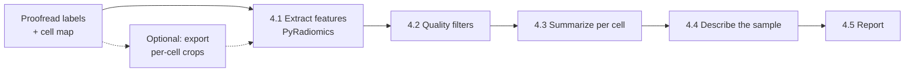

# 4. Statistical Analysis
## Goal
Extract features for each proofread object, summarize them per cell, and describe the sample: typical values, spread, and how much cells differ from each other.

## Inputs
| Item | Format | Notes |
|---|---|---|
| Proofread instance labels | `.mrc` | `<output>.mrc` from [3. Proofreading](03-proofreading.md) |
| Cell map | `.csv` | `<output>_cellmap.csv`: `instance_id → cell_id` |
| Cell labels (optional) | `.mrc`/`.tif` | Needed for volume fractions (object volume per cell volume) |
| Voxel size | nm, **x y z** | The same values used during proofreading |

## Requirements
Two environments are used (see [Scripts](#scripts)):

- **Feature extraction:** Docker, or Python 3.11 with PyRadiomics 3.0.1 (see [4.1](#41-extract-shape-features-with-pyradiomics))
- **Analysis environment** for the other scripts: Python 3.10+ with `numpy`, `pandas`, `scipy`, `matplotlib`, `mrcfile`, `statsmodels`

```bash
pip install numpy pandas scipy matplotlib mrcfile statsmodels
```
Run the scripts from `scripts/analysis/`, or give their full path.


## Overview


## Procedure

### 4.1 Extract shape features with PyRadiomics
Features are extracted per object with [PyRadiomics](https://pyradiomics.readthedocs.io) (van Griethuysen et al., 2017), using `radiomics_per_mito.py` in [`scripts/analysis/`](../scripts/analysis/). For each object, the script crops the object's mask, computes the PyRadiomics **shape** features, and writes one row per object with its cell ID.

Only the label volume is used. The raw image volume isn't read, so the results don't depend on image intensity, contrast, or how the volume was filtered, and no intensity or texture features are computed.

#### Set up the environment
PyRadiomics 3.0.1 doesn't build on recent Python or NumPy versions, so the script runs in a Docker container with pinned versions (Python 3.11, NumPy 1.26.4):

```bash
cd scripts/analysis
docker build -f Dockerfile.radiomics -t vem-radiomics .
```
The container's working folder is `/work`. Mount your project folder there when running, and give paths relative to it:
```bash
docker run --rm -v "$(pwd)":/work vem-radiomics \
    python radiomics_per_mito.py --help
```
> **Without Docker:** create a Python 3.11 environment and install the same pinned versions:
> ```bash
> conda create -n radiomics python=3.11
> conda activate radiomics
> pip install -U pip setuptools wheel
> pip install numpy==1.26.4 scipy==1.12.0 pandas==2.2.3 SimpleITK mrcfile
> pip install --no-build-isolation pyradiomics==3.0.1
> ```

#### Run on a full volume
Use the proofread instances and cell map from [3. Proofreading](03-proofreading.md):
```bash
docker run --rm -v "$(pwd)":/work vem-radiomics \
    python radiomics_per_mito.py \
        --inst_mrc    data/vol01_instances.mrc \
        --cellmap_csv data/vol01_instances_cellmap.csv \
        --out_csv     results/vol01_radiomics.csv \
        --spacing_nm  5 5 20 \
        --max_voxels_pyrad 0 \
        --verbose
```
Run this once per volume. `--spacing_nm` is in **x y z** order, the same as in the proofreader.

#### (Optional) Run on per-cell exports
Instead of whole volumes, cells can be exported as separate crops and processed one at a time. Features are identical either way; per-cell exports are useful for sharing or inspecting individual cells, or for processing selected cells only.

**1. Export the cells** with `export_cells.py` (in [`scripts/analysis/`](../scripts/analysis/)), using the proofread instances and cell map from [3. Proofreading](03-proofreading.md):

```bash
python export_cells_to_mrc.py \
    --instances_mrc data/vol01_instances.mrc \
    --mapping_csv   data/vol01_instances_cellmap.csv \
    --out_dir       exports/vol01 \
    --export_relabel
```

This runs in any environment with `numpy`, `pandas`, `scipy`, and `mrcfile`, including the Docker image. For each cell, it creates a folder:
```
exports/vol01/
├── cell_005/
│   ├── mito_labels.mrc           ← the cell's objects, original IDs
│   ├── mito_labels_relabel.mrc   ← same objects, renumbered 1..N   (--export_relabel)
│   └── meta.json                 ← crop position, original IDs, ID mapping
├── cell_006/
└── ...
```
The crop is the smallest box that contains all of the cell's objects. `meta.json` records its position in the full volume (`bbox_zyx`), the cell's original instance IDs, and, with `--export_relabel`, the mapping from new to original IDs (`relabel_map`).

| Flag | Needed for | Notes |
|---|---|---|
| `--raw_mrc` + `--export_raw` | Not needed | Exports raw image crops (`raw_vem.mrc`) for viewing; the radiomics script doesn't use them |
| `--export_relabel` | **Always use** | Keeps IDs safe (see below) and lets the radiomics output link each object back to the full volume |

> **Always use `--export_relabel`.** Labels are saved as 16-bit integers, so IDs above 65,535 wrap around in `mito_labels.mrc`. The renumbered file (`mito_labels_relabel.mrc`) is safe, and the radiomics script uses it when it exists.

> **Unassigned objects** (`cell_id` 0) are exported together as `cell_000`, spanning wherever they are in the volume. Exclude it with `--only_cells` below, or drop `cell_id == 0` rows later (4.2).

> **Voxel size in the exports** is copied from the input file's header. If the header has none, it's saved as 0. This doesn't affect features, because the radiomics script uses `--spacing_nm`, but don't rely on the exported headers elsewhere.

**2. Extract features** from the export folder:
```bash
docker run --rm -v "$(pwd)":/work vem-radiomics \
    python radiomics_per_mito.py \
        --cell_exports_dir exports/vol01 \
        --out_csv          results/vol01_radiomics.csv \
        --spacing_nm       5 5 20 \
        --max_voxels_pyrad 0
```
The cell ID is taken from the folder name. Object IDs within a crop are saved as `local_instance_id`, and the original full-volume ID as `global_instance_id`. Use `--only_cells 5 6 12` to process selected cells.

#### Features

The script computes the 14 PyRadiomics shape features. Each is a column named `original_shape_<Feature>`. Definitions are in the [PyRadiomics documentation](https://pyradiomics.readthedocs.io/en/latest/features.html#module-radiomics.shape).

**Shape features** (spacing is converted to µm, so lengths are in µm, areas in µm², volumes in µm³):
| Column | Meaning |
|---|---|
| `original_shape_MeshVolume` | Volume enclosed by the surface mesh |
| `original_shape_VoxelVolume` | Voxel count × voxel volume |
| `original_shape_SurfaceArea` | Area of the surface mesh |
| `original_shape_SurfaceVolumeRatio` | Surface area / volume |
| `original_shape_Sphericity` | How close to a sphere (1 = sphere) |
| `original_shape_MajorAxisLength`, `MinorAxisLength`, `LeastAxisLength` | Axes of the best-fitting ellipsoid |
| `original_shape_Elongation` | √(minor / major); 1 = round, lower = elongated |
| `original_shape_Flatness` | √(least / major); 1 = round, lower = flat |
| `original_shape_Maximum3DDiameter` | Largest distance between two surface points |
| `original_shape_Maximum2DDiameterSlice/Row/Column` | Largest distance within each plane |

**Bookkeeping columns:** `status` (`ok` or `error`, with the message in `error`), `voxels`, `volume_um3_voxels`, bounding-box size (`bbox_*_vox`, `bbox_*_um`), and downsampling information (`did_downsample`, `ds_zyx`, `spacing_used_um_*`).

#### Settings that affect the results
| Flag | Default | Effect |
|---|---|---|
| `--spacing_nm X Y Z` | `5 5 20` | Voxel size. **Always set it.** All shape features depend on it. |
| `--min_voxels` | `50` | Objects smaller than this are skipped |
| `--max_voxels_pyrad` | `500000` | Objects larger than this are downsampled before PyRadiomics. `0` disables downsampling. |
| `--ds_large Z Y X` | `1 2 2` | Downsampling factors for those objects |

> **What downsampling does and doesn't change.** The script accounts for downsampling: the voxel size passed to PyRadiomics is multiplied by the downsampling factors, so every feature stays in physical units, and volume and maximum diameter are essentially unchanged. Resolution **cannot** be restored. The surface mesh is built on the coarser grid, so features that depend on the surface (surface area, sphericity, surface-to-volume ratio) shift.
>
> For a compact object, downsampling actually brings surface area closer to the true value, because the full-resolution staircase overestimates it. The problem is consistency: only objects above `--max_voxels_pyrad` are downsampled, so large objects are measured on a coarser grid than small ones, and comparisons between them mix two methods. Thin structures are distorted most, since `1 4 4` leaves them only a voxel or two wide. **Use `--max_voxels_pyrad 0`** if memory allows. If downsampling is needed, keep `--ds_large 1 2 2`, check that results hold when objects with `did_downsample == True` are excluded, and report how many there were. The `volume_um3_voxels` column is always computed at full resolution.

> **Surface area is overestimated** because the mesh follows the voxel staircase, more so with anisotropic voxels (in our tests: about +9% for isotropic voxels, +19% at 5 × 5 × 20 nm). Sphericity and surface-to-volume ratio inherit this bias. It's consistent across objects measured at the same voxel size, so comparisons within a dataset are fine, but don't compare absolute surface areas with studies at different voxel sizes. Mesh volume is accurate to within about 1%.

#### Combine volumes
Combine the per-volume results into one table with `combine_results.py`. A single volume works too.

```bash
python combine_results.py \
    --volumes       vol01 vol02 \
    --radiomics_csv "results/{volume}_radiomics.csv" \
    --instances_mrc "data/{volume}_instances.mrc" \
    --out           objects.csv
```
`{volume}` in the paths is replaced by each volume ID. The script:

- keeps rows with `status == ok` and reports how many objects failed per volume
- flags objects cut off by the edge of the volume (`touches_border`), which the radiomics script doesn't record
- adds `volume_id` and a cell ID that is unique across volumes (`cell_uid`, e.g. `vol01_5`)
- adds short names for the most-used features: `volume_um3`, `surface_area_um2`, `sphericity`, `elongation`, `flatness`, `max_diameter_um`, and `aspect_ratio` (major / minor axis)

This works for both full-volume and per-cell runs. For per-cell runs, the border flag is still computed from the full volume, using each object's original ID: per-cell crops are cut tightly around the objects, so nearly every object touches a crop edge even when it is complete.

### 4.2 Quality filters
Decide these filters **before** looking at the results, and apply them the same way to every volume. `filter_objects.py` applies them and records how many objects each removed:

```bash
python filter_objects.py \
    --objects       objects.csv \
    --out           objects_filtered.csv \
    --min_voxels    TODO \
    --exclude_cells vol01_12 vol01_15
```
| Filter | Why | Default | Flag |
|---|---|---|---|
| Remove unassigned objects (`cell_id == 0`) | Can't be attributed to a cell | On | `--keep_unassigned` to turn off |
| Remove objects touching the volume border | Their size and shape are truncated | On | `--keep_border` to turn off |
| Remove very small objects | Leftover fragments and noise; shape features are unreliable for objects only a few voxels across | Off | `--min_voxels N` |
| Remove downsampled objects | Their shape features are measured on a coarser grid (see 4.1) | Off | `--exclude_downsampled` |
| Remove incompletely imaged cells | Per-cell summaries are biased | Off | `--exclude_cells` with `cell_uid` values |

The script prints the number of objects removed by each filter and saves it as `objects_filtered_filter_log.csv`; include it in the report. If downsampled objects remain, it warns you to check that results hold with `--exclude_downsampled`.

> **Border exclusion biases toward small objects.** Large objects are more likely to touch the border, so removing border objects removes proportionally more large ones. Use counts and volume fractions from all objects (4.3), and shape metrics from complete objects only.

### 4.3 Describe the sample
`describe_sample.py` summarizes each cell, summarizes the sample, finds redundant features, and plots each object grouped by cell:

```bash
python describe_sample.py \
    --objects       objects_filtered.csv \
    --out_dir       results/description \
    --features      volume_um3 surface_area_um2 sphericity elongation flatness max_diameter_um \
    --plot_features volume_um3 sphericity
```

| Output | Contents |
|---|---|
| `per_cell.csv` | One row per cell: number of objects and the median of each feature |
| `summary_objects.csv` | Median and IQR of each feature over all objects, pooled |
| `summary_cells.csv` | Median and IQR of the per-cell medians, and `cv_between_cells` |
| `redundant_pairs.csv` | Feature pairs with \|Spearman ρ\| > 0.9 (set with `--corr_threshold`) |
| `per_cell_<feature>.svg/.png` | Every object, grouped by cell, with each cell's median |

**Two levels of summary.** Each feature is summarized over all objects pooled, and across cells (one median per cell). Taking a median per cell gives each cell equal weight regardless of how many objects it contains, so cells with many small objects don't dominate. The spread across cells shows how much cells differ from each other, which the pooled numbers hide. `cv_between_cells` (coefficient of variation of the cell medians) shows which features vary most between cells.

**Median and IQR** are used rather than mean and standard deviation, because object sizes are usually right-skewed, with a few very large objects.

**Redundant features.** Many features measure nearly the same thing; volume, surface area, and diameter all track size. For each pair listed in `redundant_pairs.csv`, report one feature.

**Plots.** Size features (volume, area, lengths) are plotted on a log axis, and bounded shape features (sphericity, elongation, flatness) on a linear axis. Colors follow the Stanford palette.

### 4.4 (Optional) Volume fraction per cell
If you have a cell label volume (one ID per cell, matching the `cell_id` values in the cell map, e.g. the `--cell` volume given to the proofreader), `volume_fraction.py` computes the fraction of each cell's volume occupied by objects:

```bash
python volume_fraction.py \
    --instances_mrc data/vol01_instances.mrc \
    --cells_mrc     data/vol01_cells.mrc \
    --volume_id     vol01 \
    --spacing_nm    5 5 20 \
    --out           results/vol01_volume_fraction.csv
```

Run it once per volume. It uses all objects, including those touching the border. Volume fraction only makes sense for cells that are fully inside the volume, or when you compare equivalent regions (e.g. the same cell compartment) across samples. The script warns if object voxels lie outside any cell.

## Scripts
All scripts are in [`scripts/analysis/`](../scripts/analysis/). Run any of them with `--help` for the full list of options.

| Script | Step | Environment |
|---|---|---|
| `export_cells_to_mrc.py` | 4.1 (optional): per-cell crops | Any Python with `numpy`, `pandas`, `scipy`, `mrcfile` |
| `radiomics_per_mito.py` | 4.1: shape features | Docker image (`Dockerfile.radiomics`) or Python 3.11 with PyRadiomics 3.0.1 |
| `combine_results.py` | 4.1: combine volumes, flag border objects | Analysis environment |
| `filter_objects.py` | 4.2: quality filters | Analysis environment |
| `describe_sample.py` | 4.3: summaries, redundant features, per-cell plots | Analysis environment |
| `volume_fraction.py` | 4.4 (optional): volume fraction per cell | Analysis environment |

## Outputs
| File | Step | Contents |
|---|---|---|
| `exports/<volume>/cell_<id>/` | 4.1 | Per-cell crops (optional) |
| `results/<volume>_radiomics.csv` | 4.1 | PyRadiomics output, one row per object |
| `objects.csv` | 4.1 | Combined table: features, cell, volume, border flag |
| `objects_filtered.csv`, `objects_filtered_filter_log.csv` | 4.2 | Filtered table, and objects removed per filter |
| `results/description/per_cell.csv` | 4.3 | One row per cell: object count and feature medians |
| `results/description/summary_objects.csv`, `summary_cells.csv` | 4.3 | Median and IQR per feature, at object and cell level |
| `results/description/redundant_pairs.csv` | 4.3 | Strongly correlated feature pairs |
| `results/description/per_cell_<feature>.svg/.png` | 4.3 | Per-cell distribution plots |
| `results/<volume>_volume_fraction.csv` | 4.4 | Volume fraction per cell (optional) |

## References
- van Griethuysen JJM, Fedorov A, Parmar C, et al. (2017). Computational radiomics system to decode the radiographic phenotype. *Cancer Research* 77(21):e104–e107.

---
**Previous step:** [3. Proofreading](03-proofreading.md)
