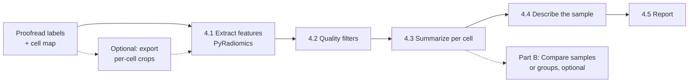

# 4. Statistical Analysis
## Goal
Extract features for each proofread object, summarize them per cell, and describe the sample: typical values, spread, and how much cells differ from each other.

If you have more than one sample, for example control and disease donors, [Part B](#part-b-optional-compare-samples-or-groups) covers how to compare them.

## Inputs
| Item | Format | Notes |
|---|---|---|
| Proofread instance labels | `.mrc` | `<output>.mrc` from [3. Proofreading](03-proofreading.md) |
| Cell map | `.csv` | `<output>_cellmap.csv`: `instance_id → cell_id` |
| Cell labels (optional) | `.mrc`/`.tif` | Needed for volume fractions (object volume per cell volume) |
| Sample metadata (Part B only) | `.csv` | One row per volume: donor, group, covariates; see [Part B](#part-b-optional-compare-samples-or-groups) |
| Voxel size | nm, **x y z** | The same values used during proofreading |

## Requirements
- Python 3.10+
- **Feature extraction:** Docker, or Python 3.11 with PyRadiomics 3.0.1 (see [4.1](#41-extract-shape-features-with-pyradiomics))
- **Summaries and plots:** Python 3.10+ with `numpy`, `pandas`, `scipy`, `matplotlib`, `mrcfile` (plus `statsmodels` for Part B)
```bash
pip install numpy pandas scipy matplotlib mrcfile statsmodels
```

## Overview


## Procedure

### 4.1 Extract shape features with PyRadiomics
Features are extracted per object with [PyRadiomics](https://pyradiomics.readthedocs.io) (van Griethuysen et al., 2017), using `radiomics_per_mito.py` in [`scripts/analysis/`](../scripts/analysis/). For each object, the script crops the object's mask, computes the PyRadiomics **shape** features, and writes one row per object with its cell ID.

Only the label volume is used. The raw image volume isn't read, so the results don't depend on image intensity, contrast, or how the volume was filtered, and no intensity or texture features are computed.

#### Set up the environment
PyRadiomics 3.0.1 doesn't build on recent Python or NumPy versions, so the script runs in a Docker container with pinned versions (Python 3.11, NumPy 1.26.4):

```bash
cd scripts/analysis
docker build -f Dockerfile.radiomics -t vem-radiomics .
```
The container's working folder is `/work`. Mount your project folder there when running, and give paths relative to it:
```bash
docker run --rm -v "$(pwd)":/work vem-radiomics \
    python radiomics_per_mito.py --help
```
> **Without Docker:** create a Python 3.11 environment and install the same pinned versions:
> ```bash
> conda create -n radiomics python=3.11
> conda activate radiomics
> pip install -U pip setuptools wheel
> pip install numpy==1.26.4 scipy==1.12.0 pandas==2.2.3 SimpleITK mrcfile
> pip install --no-build-isolation pyradiomics==3.0.1
> ```

#### Run on a full volume
Use the proofread instances and cell map from [3. Proofreading](03-proofreading.md):
```bash
docker run --rm -v "$(pwd)":/work vem-radiomics \
    python radiomics_per_mito.py \
        --inst_mrc    data/vol01_instances.mrc \
        --cellmap_csv data/vol01_instances_cellmap.csv \
        --out_csv     results/vol01_radiomics.csv \
        --spacing_nm  5 5 20 \
        --max_voxels_pyrad 0 \
        --verbose
```
Run this once per volume. `--spacing_nm` is in **x y z** order, the same as in the proofreader.

#### (Optional) Run on per-cell exports
Instead of whole volumes, cells can be exported as separate crops and processed one at a time. Features are identical either way; per-cell exports are useful for sharing or inspecting individual cells, or for processing selected cells only.

**1. Export the cells** with `export_cells.py` (in [`scripts/analysis/`](../scripts/analysis/)), using the proofread instances and cell map from [3. Proofreading](03-proofreading.md):

```bash
python export_cells_to_mrc.py \
    --instances_mrc data/vol01_instances.mrc \
    --mapping_csv   data/vol01_instances_cellmap.csv \
    --out_dir       exports/vol01 \
    --export_relabel
```

This runs in any environment with `numpy`, `pandas`, `scipy`, and `mrcfile`, including the Docker image. For each cell, it creates a folder:
```
exports/vol01/
├── cell_005/
│   ├── mito_labels.mrc           ← the cell's objects, original IDs
│   ├── mito_labels_relabel.mrc   ← same objects, renumbered 1..N   (--export_relabel)
│   └── meta.json                 ← crop position, original IDs, ID mapping
├── cell_006/
└── ...
```
The crop is the smallest box that contains all of the cell's objects. `meta.json` records its position in the full volume (`bbox_zyx`), the cell's original instance IDs, and, with `--export_relabel`, the mapping from new to original IDs (`relabel_map`).

| Flag | Needed for | Notes |
|---|---|---|
| `--raw_mrc` + `--export_raw` | Not needed | Exports raw image crops (`raw_vem.mrc`) for viewing; the radiomics script doesn't use them |
| `--export_relabel` | **Always use** | Keeps IDs safe (see below) and lets the radiomics output link each object back to the full volume |

> **Always use `--export_relabel`.** Labels are saved as 16-bit integers, so IDs above 65,535 wrap around in `mito_labels.mrc`. The renumbered file (`mito_labels_relabel.mrc`) is safe, and the radiomics script uses it when it exists.

> **Unassigned objects** (`cell_id` 0) are exported together as `cell_000`, spanning wherever they are in the volume. Exclude it with `--only_cells` below, or drop `cell_id == 0` rows later (4.2).

> **Voxel size in the exports** is copied from the input file's header. If the header has none, it's saved as 0. This doesn't affect features, because the radiomics script uses `--spacing_nm`, but don't rely on the exported headers elsewhere.

**2. Extract features** from the export folder:
```bash
docker run --rm -v "$(pwd)":/work vem-radiomics \
    python radiomics_per_mito.py \
        --cell_exports_dir exports/vol01 \
        --out_csv          results/vol01_radiomics.csv \
        --spacing_nm       5 5 20 \
        --max_voxels_pyrad 0
```
The cell ID is taken from the folder name. Object IDs within a crop are saved as `local_instance_id`, and the original full-volume ID as `global_instance_id`. Use `--only_cells 5 6 12` to process selected cells.

#### Features

The script computes the 14 PyRadiomics shape features. Each is a column named `original_shape_<Feature>`. Definitions are in the [PyRadiomics documentation](https://pyradiomics.readthedocs.io/en/latest/features.html#module-radiomics.shape).

**Shape features** (spacing is converted to µm, so lengths are in µm, areas in µm², volumes in µm³):
| Column | Meaning |
|---|---|
| `original_shape_MeshVolume` | Volume enclosed by the surface mesh |
| `original_shape_VoxelVolume` | Voxel count × voxel volume |
| `original_shape_SurfaceArea` | Area of the surface mesh |
| `original_shape_SurfaceVolumeRatio` | Surface area / volume |
| `original_shape_Sphericity` | How close to a sphere (1 = sphere) |
| `original_shape_MajorAxisLength`, `MinorAxisLength`, `LeastAxisLength` | Axes of the best-fitting ellipsoid |
| `original_shape_Elongation` | √(minor / major); 1 = round, lower = elongated |
| `original_shape_Flatness` | √(least / major); 1 = round, lower = flat |
| `original_shape_Maximum3DDiameter` | Largest distance between two surface points |
| `original_shape_Maximum2DDiameterSlice/Row/Column` | Largest distance within each plane |

**Bookkeeping columns:** `status` (`ok` or `error`, with the message in `error`), `voxels`, `volume_um3_voxels`, bounding-box size (`bbox_*_vox`, `bbox_*_um`), and downsampling information (`did_downsample`, `ds_zyx`, `spacing_used_um_*`).

#### Settings that affect the results
| Flag | Default | Effect |
|---|---|---|
| `--spacing_nm X Y Z` | `5 5 20` | Voxel size. **Always set it.** All shape features depend on it. |
| `--min_voxels` | `50` | Objects smaller than this are skipped |
| `--max_voxels_pyrad` | `500000` | Objects larger than this are downsampled before PyRadiomics. `0` disables downsampling. |
| `--ds_large Z Y X` | `1 2 2` | Downsampling factors for those objects |

> **What downsampling does and doesn't change.** The script accounts for downsampling: the voxel size passed to PyRadiomics is multiplied by the downsampling factors, so every feature stays in physical units, and volume and maximum diameter are essentially unchanged. Resolution **cannot** be restored. The surface mesh is built on the coarser grid, so features that depend on the surface (surface area, sphericity, surface-to-volume ratio) shift.
>
> For a compact object, downsampling actually brings surface area closer to the true value, because the full-resolution staircase overestimates it. The problem is consistency: only objects above `--max_voxels_pyrad` are downsampled, so large objects are measured on a coarser grid than small ones, and comparisons between them mix two methods. Thin structures are distorted most, since `1 4 4` leaves them only a voxel or two wide. **Use `--max_voxels_pyrad 0`** if memory allows. If downsampling is needed, keep `--ds_large 1 2 2`, check that results hold when objects with `did_downsample == True` are excluded, and report how many there were. The `volume_um3_voxels` column is always computed at full resolution.

> **Surface area is overestimated** because the mesh follows the voxel staircase, more so with anisotropic voxels (in our tests: about +9% for isotropic voxels, +19% at 5 × 5 × 20 nm). Sphericity and surface-to-volume ratio inherit this bias. It's consistent across objects measured at the same voxel size, so comparisons within a dataset are fine, but don't compare absolute surface areas with studies at different voxel sizes. Mesh volume is accurate to within about 1%.

#### Combine volumes

Combine the per-volume results into one table (a single volume works too), keep only successful rows, and flag objects cut off by the volume edge (the script doesn't record this). Use `combine-volumes.py` (in [`scripts/analysis/`](../scripts/analysis/))

